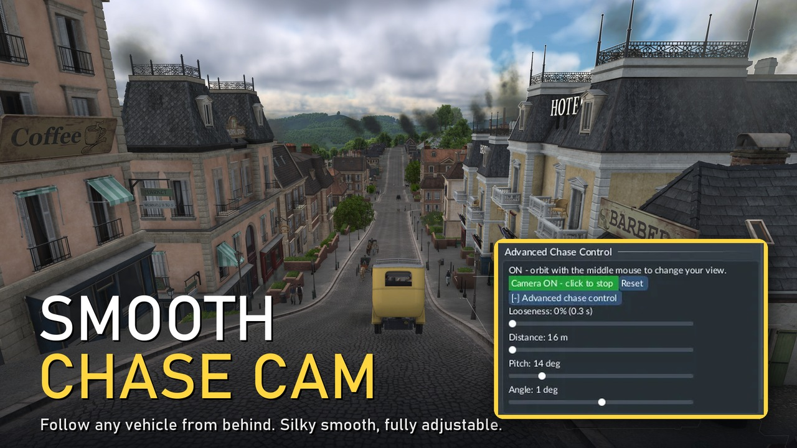

# Smooth Chase Cam

A smooth, adjustable chase camera for any vehicle in **Transport Fever 3**, started from the vehicle's own window.

**Get it:** [Smooth Chase Cam on mod.io](https://mod.io/g/transportfever3/m/smooth-chase-cam) (subscribe in the in-game Mod Hub).

## What it does
Select a vehicle, find the **Advanced Chase Control** card in its window and press **Chase camera**. The camera sits behind the vehicle and turns gently with it instead of snapping round every corner. The button turns green while the camera is on, and the card tells you why if it switches itself off.

Settings, all saved between sessions and shared by every vehicle:
- **Looseness** - how much the camera lags in turns (0.3 s to 4.3 s, shown as a percentage)
- **Distance** - 16 m to 300 m
- **Pitch** - 2 to 85 degrees
- **Angle** - move the camera round either side of "straight behind"

Orbiting with the middle mouse button while the camera is on is saved as your new view.

## Limits (all from the game, not the mod)
- The game's follow camera will not go closer than about 16 m or flatter than about 2 degrees.
- The mouse wheel does not zoom while the chase camera is on; use the Distance slider.
- Tested on road vehicles and trains. Ships, aircraft and helicopters use the same code but have had less testing.

The mod only touches the camera and the vehicle window. It is marked cosmetic, so achievements still work.

## How it works (for modders)
- `content/vehicle_cams/vc_card.res.lua` registers a card at the vehicle window's extension point (`VehicleEowExtensionPoint`).
- `vc_card.script.lua` draws the card. It runs in the GUI's Lua state, which is separate from the game script's, so it talks to the game script with `api.gui.fireGuiScriptEvent`, and the script answers with `api.gui.fireReactEvent`. The script must subscribe to each event name in its `handleEvent`.
- `vc_main.script.lua` runs every frame (`guiUpdate`). It lets the game's own follow camera (`followEntity`) own the camera centre and only rewrites distance, heading and pitch, filtered by the looseness setting.
- Camera angle `a` looks along `(-cos a, -sin a)` in map coordinates (measured in game), so to look along a vehicle direction `(dx, dy)` use `a = atan2(-dy, -dx)`.
- Settings are stored with `app.saveUserdata("towns_industries", ...)`; mod scripts have no `io`.
- Do not call GUI helpers (for example `styleutil.makeStyle`) when a script file loads: the in-game upload validator loads the files in a bare environment and fails them.

## Install by hand
Copy the `vehicle_cams_1` folder into `.../userdata/<id>/3493540/local/mods/`.

## Licence
MIT, see `LICENSE`. Made by Starhero.
